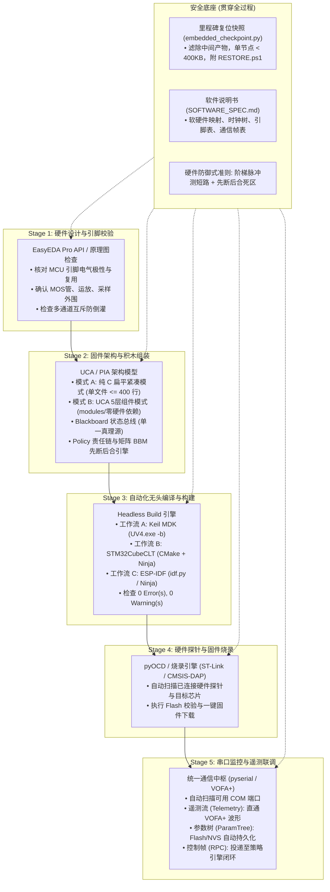

# 嵌入式软硬件全栈工程大师 (Embedded Engineering Master) v2.0

本技能作为嵌入式研发领域的**顶层编排器与总指挥（Master Orchestrator）**，将分散的硬件原理图、固件军规架构、调试器烧录与串口遥测工具链融合成一条**高可靠、自闭环的端到端软硬件研发流水线**。

v2.0 全面引入 **UCA (Unified Component Architecture 统一组件化架构)**，支持在 ARM Cortex-M 与 RISC-V / ESP32 间无缝迁移，具备“自主分级判定、纯净积木组装、动作策略责任链、矩阵安全引擎、上位机三合一协议中枢”等工业级特性。

---

## 1. 架构自主分级判定与报备机制 (Autonomous Tiering Protocol)

在接收到新工程、代码分析或开发需求时，Agent 必须**主动扫描目标特征并自主判定架构模式**，在前置确认中告知用户：

```
                              ┌────────────────────────────────────────┐
                              │  新需求 / 工程特征自主扫描与画像分析   │
                              └───────────────────┬────────────────────┘
                                                  │
                 ┌────────────────────────────────┴────────────────────────────────┐
                 ▼ (Flash <= 64KB, RAM <= 16KB, 极简裸机)                          ▼ (Flash >= 128KB, RAM >= 32KB, 复杂/网络)
      【模式 A：极简紧凑模式】                                          【模式 B：综合组件模式 (UCA)】
      • 纯 C99，扁平单层目录 (main.c/app.c/bsp.c)                       • 现代 C++20 / C++17，5层组件目录
      • 拒绝虚函数与动态分配，极小 Flash/RAM 占用                       • OSAL (FreeRTOS) + PAL 硬件屏蔽
      • SysTick 时间片轮询，VOFA+ JustFloat 波形                        • Blackboard 状态总线 + 责任链策略引擎
```

* **前置报备规范**：
  > *“检测到目标芯片为 **[芯片型号]（Flash [X]KB / RAM [Y]KB）**。  
  > **【架构判定】**：当前资源与需求匹配 **[极简紧凑模式 / 综合组件模式]**。  
  > 依据：[判定理由，如避免虚表占用Flash / 支持多任务与屏幕UI]。正在按此架构标准推进……”*

---

## 2. 全生命周期工程流水线 (The 5+1 Pipeline)



---

## 3. 标准作业程序 (Master SOP)

当接收到全流程开发、功能闭环或软硬件综合排查需求时，按以下次序推进：

### 阶段 1：硬件图纸与引脚核对 (Hardware Grounding)
1. 检查根目录 [`SOFTWARE_SPEC.md`](file:///E:/ST/STM32_WorkSpace/F103c8t6_qibeng/SOFTWARE_SPEC.md) 或调用 [`easyeda-api`](file:///C:/Users/hejia/.gemini/config/skills/easyeda-api/SKILL.md) 读取原理图；
2. 确认被控对象的物理位号、MCU GPIO 引脚编号、工作极性；
3. **多路/矩阵防短路审查**：核查是否存在多个不同电源/通道并联可能引发短路的拓扑，强制建立排他性互斥规则；
4. **电源与外围芯片工作模式引脚核验 (PMIC Mode Pin Grounding)**：针对 PMIC、电池充电芯片（如 MP2672、BQ 系列）或专用接口 IC，严格核验模式配置引脚（如 `CV`、`PROG`、`MODE`）。杜绝误接地/误下拉进入 Standalone 自主硬件模式导致 I2C 从机逻辑被完全关闭（表现为总线全地址 NACK）；确认上拉进入 Host-Control 主机控制模式方可进行总线通信。
5. **硬件时钟源三方交叉核验 (Clock Triangulation Rule)**：排查或配置系统时钟树时，严禁单凭早期文档文字断定外部晶振频率。必须对齐“实物 BOM 丝印型号 ∩ CubeMX `.ioc` (HSE_VALUE) ∩ 运行时代码寄存器 (PLLM)”，核验三者严格一致方可进行分频倍频配置；
6. **CubeMX `.ioc` 强同步防覆写免疫 (Zero-Patch Overwrite Immunity)**：所有 GPIO 内部上拉/下拉、外设工作模式（SPI/I2C/UART）与时钟分频，必须反向固化至 `.ioc` 配置文件中。严禁在生成文件（`Core/Src/`）中仅做手工临时补丁，彻底防范用户重新 GENERATE CODE 时手改代码全盘被冲掉。

### 阶段 2：固件架构选择与编码 (Firmware Engineering)
1. **执行架构自主分级**：根据目标芯片 Flash/RAM 与复杂度选择【极简紧凑模式】或【UCA 综合组件模式】；
2. **纯净积木原则**：`modules/` 内业务代码禁止包含硬件厂商头文件（如 `stm32f4xx.h`），确保具备 PC 宿主机脱机测试能力；
3. **安全责任链与矩阵控制**：
   - 功率开启前挂载阶梯短路微脉冲探测（`ShortCircuitDetect`）；
   - 矩阵与通道切换强制走 **Break-Before-Make（先断后合）**与死区延时（Dead-time）；
   - 详细接口与目录规约见 [UCA 架构规范文档](references/uca_architecture_spec.md)；
4. **I2C 总线自愈与死锁防范 (9-Clock Recovery & AF Remapping)**：涉及 I2C 传感器与电源芯片时，必须注入标准 9-Clock GPIO 解死锁时序，并强制做 `GPIO_MODE_AF_OD` 复用回切与 `HAL_I2C_DeInit()` 状态机复位，防止从机钳位 SDA 导致总线卡死在 BUSY 状态。
5. **过渡期脚手架即时物理拆除规约 (Scaffolding Deconstruction Standard)**：带板联调中为确认屏幕尺寸、外设通道所引入的过渡期脚手架代码（如多尺寸轮播数组、对比测试函数），在硬件规格一旦被闭环确认后，必须在当前周期内彻底物理删除，杜绝死代码污染生产工程；
6. **外设驱动单文件 400 行解耦**：屏幕驱动等大初始化数组必须外置至 `*_cfg.h`，主驱动收敛在 300 行内，严禁将宿主机环境（如 `COM5`）硬编码至设备 UI；
7. **上下位机原子同步契约 (Dual-End Atomic Synchronization Standard)**：
   * **契约先行 (Contract First)**：系统 UI 模式、遥测数据帧、控制指令必须首先在 MCU 中央黑板或通信服务头文件（如 `sys_blackboard.h` / `proto_*.h`）中显式定义枚举（如 `UiMode_t`），严禁使用裸写魔数；
   * **双端原子协同演进**：下位机固件新增功能、重构状态机或调整遥测帧格式时，上位机 UI、数据模型与命令解析必须在同一迭代内同步交付，严禁单端推进导致协议漂移；
   * **遗留技术债务清零**：功能重构完成后，必须全量物理清除上位机与下位机中的历史容错遗迹（如旧轮播残留、过时函数命名 `resume_carousel`、旧模式号容错映射），确保双端语义绝对统一。

### 阶段 3：自动化静默编译 (Headless Build)
根据工程类型选择对应的无头构建引擎：
* **工作流 A (Keil MDK-ARM)**：调用 UV4 静默构建并校验构建日志；
* **工作流 B (Modern CMake / STM32CubeCLT)**：调用 CMake + Ninja 毫秒级并发编译；
* **工作流 C (ESP-IDF)**：调用 `idf.py build` 并监测 Flash 分区（确保 `app` 占用率处于安全线以下）。

### 阶段 4：硬件探针检测与固件烧录 (Flash & Program)
1. 联动 [`cortex-m-pyocd`](file:///C:/Users/hejia/.gemini/config/skills/cortex-m-pyocd/SKILL.md) 扫描探针与目标芯片；
2. 执行一键 Flash 擦除与固件下载。

### 阶段 5：串口实时监听与遥测联调 (Serial Telemetry)
1. 联动 [`industrial-serial-agent`](file:///C:/Users/hejia/.gemini/config/skills/industrial-serial-agent/SKILL.md) 监听串口日志；
2. 激活统一通信中枢：
   * 极简模式：输出 VOFA+ JustFloat 尾帧（`\x00\x00\x80\x7F`）；
   * 综合模式：三合一协议引擎（遥测波形 + 参数读写 + RPC 控制帧）。

### 阶段 6：工程自洁收尾、健康审计与快照归档 (Hygiene, Audit & Snapshot DoD)
任何功能开发、问题排查或架构调整交付前，必须执行三步交付自检（Definition of Done）：
1. **工作区卫生自洁 (Workspace Hygiene)**：
   * 清理零散日志：立即清除根目录与构建目录下的 `.log`、临时 `.txt`、`.tmp`、调试备份等中间脏污；
   * 权威资料去重归位：所有硬件/软件规格书统一归入 `docs/`，严禁在根目录并存重复副本；根目录提供统一入口 `README.md`；
   * 工具链权责严密分立：MCU 固件构建与字库脚本统一归入 `Tools/Firmware/`，严禁污染 `Host/` 上位机目录。
2. **自动化工程健康度审计**：
   * 运行工程内置审计工具（如 `python Tools/check_project_health.py`），核验目录干净度、架构层级完整性与上下位机协议一致性，确保 100% 审计通过。
3. **节点复位快照归档与说明书同步**：
   * 运行 `embedded_checkpoint.py` 固化关键里程碑快照；
   * 同步更新 `docs/SOFTWARE_SPEC.md` 与工程根目录 [`README.md`](file:///E:/ST/STM32_WorkSpace/F103c8t6_qibeng/SOFTWARE_SPEC.md)。

---

## 4. 编排器与专项子技能的协同分工

| 业务场景 | 负责技能 | 触发方式 |
| :--- | :--- | :--- |
| **端到端全流程开发与架构编排** | **`embedded-engineering-master`** (本编排器) | *“全链路开发”*、*“端到端调通”*、*“从原理图到板子跑通”* |
| **仅查原理图与 PCB** | [`easyeda-api`](file:///C:/Users/hejia/.gemini/config/skills/easyeda-api/SKILL.md) | *“立创EDA启动”*、*“检查原理图引脚”* |
| **STM32 专属军规代码重构** | [`embedded-stm32-rules`](file:///C:/Users/hejia/.gemini/config/skills/embedded-stm32-rules/SKILL.md) | *“按照 PIA 架构重构”*、*“检查 C 嵌入式规则”* |
| **硬件探针与固件烧录** | [`cortex-m-pyocd`](file:///C:/Users/hejia/.gemini/config/skills/cortex-m-pyocd/SKILL.md) | *“检测探针”*、*“烧录 hex 固件”* |
| **串口监听与通讯测试** | [`industrial-serial-agent`](file:///C:/Users/hejia/.gemini/config/skills/industrial-serial-agent/SKILL.md) | *“扫一下 COM 口”*、*“监听串口”* |
