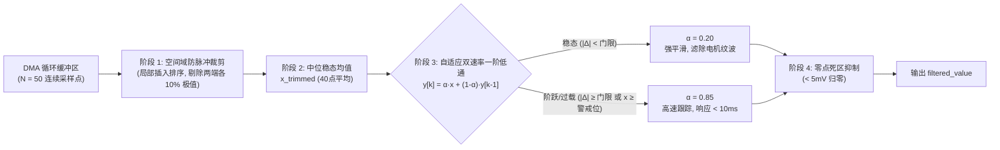

# STM32 ADC 传感器与动力采样滤波工程规范 (ADC Filtering Patterns)

在嵌入式 MCU（尤其是 Cortex-M0/M3/M4/M7）的模拟量采集链路中，面对不同的负载类型（阻性传感器 vs 电机感性负载），必须遵循**“按需选型、分级部署”**的双选规约。

---

## 1. 滤波选型决策矩阵 (Decision Matrix)

| 维度 | 选项 A：高精度感性负载自适应复合滤波 (Composite) | 选项 B：低量化轻量平滑滤波 (Low-Quantization) |
| :--- | :--- | :--- |
| **典型适用负载** | 直流有刷电机、步进电机、电磁阀、继电器、动力电池高侧采样 | NTC 温度、电位器摇杆、光敏电阻、直流母线电压、分压阻性采样 |
| **核心干扰特征** | 电刷换向电弧火花、感性关断高频反峰、MOSFET 开关尖峰、运放偏置底噪 | 高频白噪声、电源轻微工频纹波、环境工频偶发跳字 |
| **动态特性要求** | 兼顾稳态高信噪比平滑与**毫秒级过流/堵转突变零延迟断路保护** | 缓变信号跟踪，无需毫秒级阶跃断路保护 |
| **计算与内存开销** | 需抽取 DMA 样本局部排序（微秒级）+ 浮点/定点自适应比较 | 纯定点加法与移位运算（CPU 耗时 < 10 周期，零乘除法） |
| **适用内核** | Cortex-M3 / M4F / M7 (主频 >= 48MHz) | Cortex-M0 / M0+ / M3 / M4 (低功耗或极低算力场景) |

---

## 2. 选项 A：高精度感性负载自适应复合滤波 (Adaptive Composite Filter)

### 2.1 算法三级流水线


### 2.2 核心代码模板
```c
#define ADC_CH_NUM          3
#define ADCCOUNT            50
#define ADC_TRIM_COUNT      5     /* 剔除两端各 5 点 (共淘汰 20% 尖峰) */
#define ADC_VALID_COUNT     (ADCCOUNT - 2 * ADC_TRIM_COUNT)

#define ADC_ALPHA_SLOW      0.20f /* 稳态滤波系数 */
#define ADC_ALPHA_FAST      0.85f /* 突变跟踪系数 (防过载延迟) */
#define ADC_STEP_FAST_THRES 0.300f/* 300mA 阶跃切换 FAST */
#define ADC_OVERLOAD_PRE_THRES 1.000f /* 接近 1.2A 熔断门限强制 FAST */
#define ADC_ZERO_DEADBAND   0.005f/* < 5mA 归零 */

static void Adc_InsertionSort(uint16_t *arr, uint16_t len)
{
    uint16_t i;
    for (i = 1; i < len; i++) {
        uint16_t key = arr[i];
        int16_t j = (int16_t)i - 1;
        while (j >= 0 && arr[j] > key) {
            arr[j + 1] = arr[j];
            j--;
        }
        arr[j + 1] = key;
    }
}

void Filter_Process_Composite(float *out, uint16_t *dma_buf)
{
    uint8_t ch;
    uint16_t ch_buf[ADCCOUNT];
    const float trim_scale = 3.3f / (4095.0f * (float)ADC_VALID_COUNT);

    for (ch = 0; ch < ADC_CH_NUM; ch++) {
        uint16_t i;
        uint32_t trim_sum = 0;
        for (i = 0; i < ADCCOUNT; i++) {
            ch_buf[i] = dma_buf[i * ADC_CH_NUM + ch];
        }
        Adc_InsertionSort(ch_buf, ADCCOUNT);
        for (i = ADC_TRIM_COUNT; i < (ADCCOUNT - ADC_TRIM_COUNT); i++) {
            trim_sum += ch_buf[i];
        }
        float x_trimmed = (float)trim_sum * trim_scale;

        /* 自适应一阶滞后 */
        float prev_y = s_filter[ch].val;
        float diff = (x_trimmed > prev_y) ? (x_trimmed - prev_y) : (prev_y - x_trimmed);
        float alpha = (x_trimmed >= ADC_OVERLOAD_PRE_THRES || diff >= ADC_STEP_FAST_THRES) 
                      ? ADC_ALPHA_FAST : ADC_ALPHA_SLOW;
        s_filter[ch].val = alpha * x_trimmed + (1.0f - alpha) * prev_y;

        /* 零点死区 */
        if (s_filter[ch].val < ADC_ZERO_DEADBAND) {
            s_filter[ch].val = 0.0f;
        }
        out[ch] = s_filter[ch].val;
    }
}
```

---

## 3. 选项 B：低量化轻量平滑滤波 (Low-Quantization Bit-Shift Filter)

### 3.1 算法特点
* **零乘除法**：全流水线仅使用加减法与右移位运算（Bit-Shift）。
* **硬件级高吞吐**：利用 $2^N$ 采样深度（如 16 或 32 点），直接由累加和右移获取瞬时平均值。
* **低量化定点 IIR**：
  $$y_k = y_{k-1} + ((x_k - y_{k-1}) \gg S)$$
  其中平滑位移阶数 $S = 2$ 或 $3$（等效 $\alpha = 0.25$ 或 $0.125$）。

### 3.2 核心代码模板
```c
#define LOW_QUANT_SHIFT     4   /* 16点 DMA 窗口: sum >> 4 等效除以 16 */
#define LOW_QUANT_POINTS    (1 << LOW_QUANT_SHIFT)
#define IIR_SMOOTH_SHIFT    2   /* 一阶定点滞后: (diff >> 2), 等效 alpha = 0.25 */

typedef struct {
    uint16_t filtered_raw; /* 12位定点滤波值 (0~4095) */
    uint16_t filtered_mv;  /* 换算毫伏 */
} LowQuantFilter_t;

static LowQuantFilter_t s_lq_filters[ADC_CH_NUM] = {0};

void Filter_Process_LowQuant(uint16_t *out_mv, uint16_t *dma_buf)
{
    uint8_t ch;
    for (ch = 0; ch < ADC_CH_NUM; ch++) {
        uint32_t sum = 0;
        uint16_t i;
        for (i = 0; i < LOW_QUANT_POINTS; i++) {
            sum += dma_buf[i * ADC_CH_NUM + ch];
        }
        uint16_t x_raw = (uint16_t)(sum >> LOW_QUANT_SHIFT);

        /* 定点整数一阶滞后: y = y + (x - y) >> 2 */
        int32_t diff = (int32_t)x_raw - (int32_t)s_lq_filters[ch].filtered_raw;
        s_lq_filters[ch].filtered_raw += (int16_t)(diff >> IIR_SMOOTH_SHIFT);

        /* 快速定点换算 mV: 4095 -> 3300mV (乘 3300 移位 12 位: (raw * 3300) >> 12) */
        s_lq_filters[ch].filtered_mv = (uint16_t)(((uint32_t)s_lq_filters[ch].filtered_raw * 3300U) >> 12);
        out_mv[ch] = s_lq_filters[ch].filtered_mv;
    }
}
```

---

## 4. 统一宏配置无缝切换规约 (Unified Macro Switch Standard)

在驱动模块 `adc_bsp.h` 或 `config.h` 中提供标准开闭选项：

```c
/* ==================================================================== */
/*                  ADC 滤波算法模式选型开关 (按需配置)                 */
/* ==================================================================== */
#define ADC_FILTER_MODE_COMPOSITE    1   /* 选项 A: 感性负载自适应复合滤波 (去极值+变系数IIR+死区) */
#define ADC_FILTER_MODE_LOW_QUANT    2   /* 选项 B: 低量化轻量位移滤波 (纯整数移位/极低CPU开销) */

/* 当前工程生效配置 */
#define ACTIVE_ADC_FILTER_MODE       ADC_FILTER_MODE_COMPOSITE
```
在代码编译阶段通过条件编译分支驱动，严禁在运行时加入无意义的动态模式分支判断，确保确定性实时执行。
