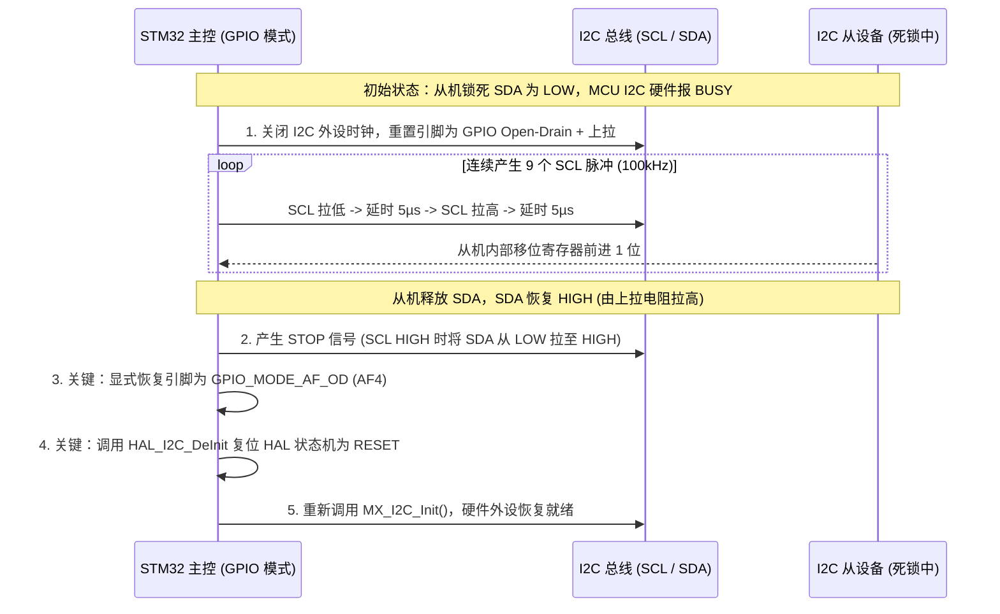

# I2C 总线死锁恢复时序规约与电源管理 IC 模式引脚硬件陷阱指南

> **适用场景**：STM32 / ARM Cortex-M 平台 I2C 外设驱动设计、开机总线自愈、智能电源管理 IC (PMIC/Charger 如 MP2672, BQ 系列) 联调与硬件故障诊断。

---

## 1. STM32 硬件 I2C 总线死锁机理与 9-Clock 解死锁时序

### 1.1 总线死锁机理 (SDA Clamp Low)
在嵌入式系统中，当单片机经历软件复位、看门狗复位或在线仿真打断时，若从机（如传感器、EEPROM、PMIC）恰好处于数据传输阶段且正在向总线输出逻辑 `0`（例如应答 ACK 位或数据位 0）：
1. 主控复位后重新初始化 I2C 外设，检测到 SDA 线路被外部从机强制拉低；
2. STM32 硬件 I2C 控制器根据规范判定总线为“被占用”（`BUSY` 标志位置位）；
3. 任何后续的 `HAL_I2C_Master_Transmit` 或 `HAL_I2C_Mem_Read` 调用均会因等待总线空闲而直接超时失败，返回 `HAL_BUSY` 或 `HAL_ERROR`。

### 1.2 标准 9-Clock GPIO 总线恢复时序
必须通过软件模拟 9 个 SCL 时钟脉冲，迫使从机移出剩余数据位并放弃对 SDA 的控制，随后产生 STOP 条件使总线回到空闲状态。



### 1.3 核心实现代码与双重陷阱防范

```c
/**
  * @brief 彻底恢复锁死的 I2C 总线并重建 STM32 硬件外设连接
  * @note  必须防范 AF4 复用失效与 HAL 状态机未复位两大陷阱
  */
void I2C_Bus_Recover(void)
{
    GPIO_InitTypeDef GPIO_InitStruct = {0};

    /* 1. 禁用 I2C1 硬件外设与时钟 */
    __HAL_RCC_I2C1_CLK_DISABLE();

    /* 2. 临时将 SCL / SDA 配置为普通开漏 GPIO 输出并启用上拉 */
    GPIO_InitStruct.Pin = GPIO_PIN_8 | GPIO_PIN_9;
    GPIO_InitStruct.Mode = GPIO_MODE_OUTPUT_OD;
    GPIO_InitStruct.Pull = GPIO_PULLUP;
    GPIO_InitStruct.Speed = GPIO_SPEED_FREQ_VERY_HIGH;
    HAL_GPIO_Init(GPIOB, &GPIO_InitStruct);

    HAL_GPIO_WritePin(GPIOB, GPIO_PIN_8 | GPIO_PIN_9, GPIO_PIN_SET);
    for (volatile uint32_t i = 0; i < 200U; i++);

    /* 3. 产生 9 个时钟方波脉冲 (驱动从机释放 SDA) */
    for (uint8_t i = 0; i < 9U; i++)
    {
        HAL_GPIO_WritePin(GPIOB, GPIO_PIN_8, GPIO_PIN_RESET);
        for (volatile uint32_t d = 0; d < 50U; d++);
        HAL_GPIO_WritePin(GPIOB, GPIO_PIN_8, GPIO_PIN_SET);
        for (volatile uint32_t d = 0; d < 50U; d++);
    }

    /* 4. 产生标准 I2C STOP 条件 */
    HAL_GPIO_WritePin(GPIOB, GPIO_PIN_9, GPIO_PIN_RESET);
    for (volatile uint32_t d = 0; d < 50U; d++);
    HAL_GPIO_WritePin(GPIOB, GPIO_PIN_8, GPIO_PIN_SET);
    for (volatile uint32_t d = 0; d < 50U; d++);
    HAL_GPIO_WritePin(GPIOB, GPIO_PIN_9, GPIO_PIN_SET);
    for (volatile uint32_t d = 0; d < 50U; d++);

    /* ========================================================
     * 【致命陷阱 1 防范】：必须显式将引脚重新配置为复用开漏模式 (AF4)
     * 若缺少此步，MX_I2C1_Init() 内部不会强制刷新 MSP，引脚将永久留在普通 GPIO 模式！
     * ======================================================== */
    GPIO_InitStruct.Mode = GPIO_MODE_AF_OD;
    GPIO_InitStruct.Alternate = GPIO_AF4_I2C1;
    HAL_GPIO_Init(GPIOB, &GPIO_InitStruct);

    /* ========================================================
     * 【致命陷阱 2 防范】：必须将 HAL 状态机复位为 HAL_I2C_STATE_RESET
     * 否则 HAL_I2C_Init() 会直接跳过底层初始化逻辑返回 HAL_BUSY
     * ======================================================== */
    HAL_I2C_DeInit(&hi2c1);
    __HAL_RCC_I2C1_CLK_ENABLE();
    __HAL_RCC_I2C1_FORCE_RESET();
    for (volatile uint32_t i = 0; i < 100U; i++);
    __HAL_RCC_I2C1_RELEASE_RESET();

    /* 5. 重新执行硬件外设初始化 */
    MX_I2C1_Init();
}
```

---

## 2. 电源管理芯片 (MP2672 / BQ系列) 通信硬件陷阱与模式引脚

在进行双电芯/多电芯锂电池升降压充电 IC 调试时，工程师常遭遇“硬件焊接良好、供电正常、波形无短路，但 I2C 全总线扫描（0x08~0x77）全返回 NACK”的隐蔽故障。其根本原因多为**模式配置引脚处于硬件自主模式**。

### 2.1 MP2672 芯片 CV 引脚的模式二重性
以 MPS **MP2672**（2S 锂电池 2A 升压充电与电芯均衡管理芯片）为例：

| CV 引脚硬件连接 | 芯片运行模式 | I2C 接口状态 | 寻址结果 (0x4B) | 功能特征 |
| :--- | :--- | :--- | :--- | :--- |
| **下拉接地 (Pull-Down to GND)** | **Standalone Mode**<br>(自主硬件模式) | **内部完全关闭并旁路** | **全总线 NACK** (无响应) | 充饱截止电压固定由硬件电阻网络决定，电芯均衡与充电电流不可由 MCU 软件调控。 |
| **上拉至 Pin 4 VCC (~3.6V)** | **Host-Control Mode**<br>(主机 I2C 控制模式) | **启用 (7-bit: 0x4B)** | **返回正常 ACK** | 允许主控 MCU 读写所有 5 个核心寄存器，动态调整 8.4V~8.8V 充饱阈值、电流、定时器与看门狗。 |

> [!WARNING]
> **设计检查要点**：
> 1. **严禁将 CV 引脚上拉至 STM32 的 3.3V 外部电源**：必须直接上拉至 MP2672 自身的 Pin 4（`VCC`，内部 LDO 输出），避免反向倒灌与上电时序竞争。
> 2. **供电与内部 `VCC` LDO 启动排查**：实机仅接 ST-Link（只供 MCU 3.3V）而无 `VIN`（USB 5V）或 `BATT`（2S 电池）时，MP2672 内部逻辑不工作，I2C 全地址扫描必返回 NACK；若怀疑供电/模式引脚异常，先行用万用表实测 Pin 4（`VCC`）及 `VIN` 电压再排查 I2C 时序。

### 2.2 MP2672 寄存器速查表 (Host-Control 模式)

| 寄存器地址 | 默认值 | 关键位域定义 | 典型工程配置 |
| :--- | :--- | :--- | :--- |
| `0x00 Config0` | `0x38` | • `[7:5] VBATT_REG`: 001 = 8.40V, 010 = 8.50V<br>• `[4] EN_CHG`: 1 = 充电使能, 0 = 充电关闭<br>• `[3:1] VSYS_MIN`: 100 = 3.4V 最低系统工作电压 | `0x38` (2S 标称充饱 8.4V，开启充电) |
| `0x01 Config1` | `0x8F` | • `[7] EN_BAL`: 1 = 启用电芯主动均衡, 0 = 禁用<br>• `[6:0] ICHG`: 充电电流步进设定 (50mA/LSB) | `0x8F` (开启均衡，适配 2S 电池寿命管理) |
| `0x02 Config2` | `0x95` | • `[7:6] CHG_TMR`: 10 = 10h 充电超时保护<br>• `[5:4] WATCHDOG`: 01 = 40s 通信看门狗, 00 = 禁用 | `0x95` 或 `0x85` (根据是否需要主控周期性喂狗) |
| `0x03 Status` | 只读 | • `[7:6] VBUS_STAT`: 01 = USB 正常供电<br>• `[5:4] CHG_STAT`: 00 = 未充, 01 = 预充, 10 = 快充, 11 = 充饱<br>• `[3:2] NTC_FAULT`: 00 = 正常温度范围 | 状态轮询与仪表盘电量/充电状态呈现 |
| `0x04 Fault` | 读后清零 | • `[7] WATCHDOG_FAULT`: 看门狗超时标记<br>• `[2] THERM_SD`: 芯片过热关断<br>• `[1:0] BAT_FAULT`: 01 = 电池过压 (BATOVP) | 异常告警与过压熔断保护判定 |

---

## 3. 工程排查 SOP (I2C 从机不响应一键诊断链)

```
[I2C 扫描返回 0 个从机]
          │
          ├── 1. 物理引脚电平量测:
          │      PB8 (SCL) 是否 HIGH? PB9 (SDA) 是否 HIGH?
          │      --> 若为 LOW: 检查外部上拉电阻 (4.7kΩ) 是否虚焊，或总线被从机拉死。
          │
          ├── 2. 模式引脚核对 (PMIC 专用):
          │      核对 MP2672 / BQ 模式引脚是否被硬件误接下拉 (切入了 Standalone 模式)。
          │      --> 必须将模式引脚改接为上拉进入 Host-Control 模式。
          │
          ├── 3. 执行标准 9-Clock Bus Recovery:
          │      产生 9 个脉冲并复位 STOP 条件。
          │      --> 检查恢复后是否显式配置了 GPIO_MODE_AF_OD (AF4) 与 HAL_I2C_DeInit。
          │
          └── 4. 示波器 / 逻辑分析仪抓包:
                 观察第九个时钟沿从机是否将 SDA 拉低 (ACK 应答)。
```
