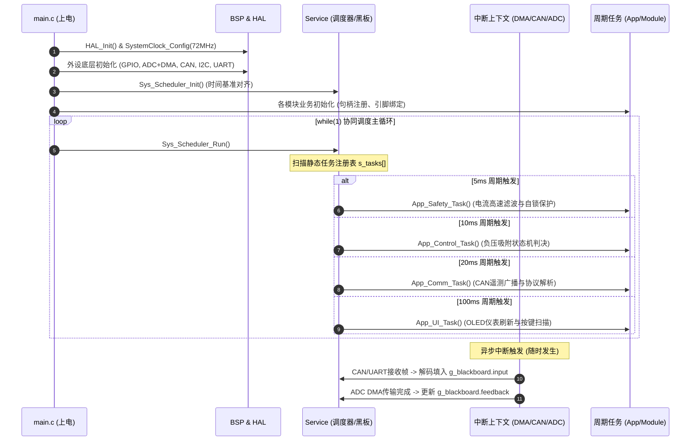

# 嵌入式工程软件设计与说明书标准规范 (Software Specification Standard)

本规范为嵌入式固件工程定义了一套**“工程全景透彻、代码架构清晰、针对移交友好、具备前瞻升级考量”**的软件说明书标准。每个工程均应在根目录下维护该说明书（建议命名为 `SOFTWARE_SPEC.md` 或项目根目录 `README.md`）。

---

## 1. 软件说明书设计原则

1. **工程业务直击本质**：用通俗、严谨的工程师语言，第一段讲清楚板子是干什么的、工作场景是什么、一次完整的动作闭环是如何流转的。
2. **架构透明方便移交**：为新人或协作团队提供完整的“代码地图”、生命周期执行流、核心数据流图以及二次开发指引，接手者 10 分钟内即可定位任意代码并进行扩展。
3. **前后向演进兼容**：明确规划 Flash 分区、IAP/OTA 升级接口、未分配引脚与协议预留字段。
4. **软硬件电气强透明**：明确引脚电气极性（高/低有效）、上下拉模式与安全默认电平。

---

## 2. 标准说明书模板结构 (带架构解读与移交指引)

```markdown
# [项目/固件名称] 软件设计与工程移交说明书

> **文档版本**：V1.0  
> **适用硬件**：[主板型号 / PCB版本 / MCU型号 / 关键传感器与执行器]  
> **固件架构**：PIA (Progressive Instance-driven Architecture)  
> **移交/维护负责人**：[姓名/团队]  

---

## 1. 工程业务概览与工作逻辑导读 (Project Overview & Executive Summary)

### 1.1 系统定位与业务场景
*简要阐述本硬件与固件在整机/产线/机器人中的定位与解决的核心问题：*
* **系统角色**：例如“本板作为工业机械臂末端智能气动执行器控制板，负责高频负压吸附检测、破真空快速释放与状态遥测”。
* **交互对象**：上位机（工控机/PLC/ROS机器人主控）、外接动力机构（3路气泵、3路电磁阀）、外部传感（INA139电流检测芯片、I2C OLED）。

### 1.2 核心工况端到端闭环流程
*用文字或步骤图描述系统上电后的典型业务执行闭环：*
1. **上电自检阶段**：时钟树与外设初始化，读取传感器基线漂移，OLED 显示就绪状态，CAN/串口开始监听。
2. **吸附捕获阶段**：接收到上位机吸附指令 -> 启动对应通道动力气泵 -> ADC 高频采样电流 -> 判定负压建立成功 -> 遥测反馈 `VAC_GET` 状态。
3. **破真空释放阶段**：接收到释放指令 -> 关断气泵 -> 启动硬件延时缓冲 -> 触发电磁泄气阀脉冲 -> 负压瞬间释放 -> 恢复待机。
4. **异常自锁保护**：若发生管路堵转或短路，电流超出门限，硬件毫秒级切断并置位自锁，阻止硬件烧毁。

---

## 2. 核心系统规格 (System Specifications)

| 规格项 | 参数 / 配置 | 说明 |
| :--- | :--- | :--- |
| **MCU 型号** | STM32F103C8T6 (LQFP48) | 32-bit ARM Cortex-M3 |
| **系统主频** | 72 MHz | 外部 8.000 MHz 晶振，PLL 9倍频 |
| **存储资源** | Flash: 64 KB, SRAM: 20 KB | 编译占用率：Flash 58%, RAM 31% |
| **调度内核** | PIA 静态时间片协同调度器 (Level 1/2) | 无 RTOS 开销，微秒级执行确定性 |
| **调试接口** | SWD (SWCLK: PA14, SWDIO: PA13) | 3.3V 逻辑电平 |

---

## 3. 软硬件映射与外设电气特性 (Pinout & Electrical Interface)

| 逻辑功能 | MCU 引脚 | 外设类型 | 电气极性与模式 | 硬件对接设备与物理位号 | 故障自保默认电平 |
| :--- | :---: | :--- | :--- | :--- | :---: |
| **执行器-气泵1** | PA4 | GPIO_Output | 推挽输出，高电平导通 | 驱动 MOS `Q1` -> PUMP1 端子 | 低电平 (关断) |
| **执行器-阀门1** | PA5 | GPIO_Output | 推挽输出，高电平泄气 | 驱动 MOS `Q11` -> VALVE1 端子| 低电平 (密封) |
| **传感-电流采样1**| PA1 | ADC1_IN1 (DMA)| 模拟输入 (0~3.3V, 1V=1A) | INA139 电流采样运放输出 | - |
| **总线-CAN 通信**| PA11/12 | CAN 2.0A | 1 Mbps, 差分总线 | MAX3051 CAN 收发器 | 内部弱上拉 |
| **调试-串口通信**| PA9/10 | USART1 | 115200 8N1 | 外部 TTL 调试端子 | - |

---

## 4. 代码架构深度解读与移交指南 (Architecture Deep Dive & Handover)

### 4.1 目录分层与职责索引表 (代码地图)
*为便于移交，明确各层各文件的具体职责，禁止跨层乱翻代码：*

| 目录层级 | 文件名 | 职责与功能 | 对外核心接口 / 句柄 |
| :--- | :--- | :--- | :--- |
| **`BSP/`** | `bsp_gpio.c/.h` | 片上引脚高低电平与模式封装 | `BSP_GPIO_Set()`, `BSP_GPIO_Read()` |
| | `bsp_can.c/.h` | CAN 外设过滤器配置与 DMA 环形收发 | `BSP_CAN_Transmit()`, `BSP_CAN_RxCallback()` |
| | `bsp_adc.c/.h` | ADC 多通道连续 DMA 循环采样驱动 | `BSP_ADC_GetRawValues()` |
| **`Module/`** | `actuator_pump.c/.h` | 气泵/阀门句柄抽象与硬件互锁防呆 | `PumpValve_t`, `PumpValve_Set()` |
| | `oled_ssd1306.c/.h`| 0.96寸 OLED 驱动与显存 DMA 传输 | `OLED_DrawString()`, `OLED_Update()` |
| | `key_filter.c/.h` | 独立按键状态机三态消抖 (单击/长按) | `Key_Scan()`, `Key_GetEvent()` |
| **`Service/`** | `sys_scheduler.c/.h`| 静态时间片协同轮询调度表 | `Sys_Scheduler_Init()`, `Sys_Scheduler_Run()` |
| | `sys_blackboard.h` | 系统中央数据黑板池 (数据解耦总线) | `g_blackboard` 状态结构体 |
| | `proto_can.c/.h` | 上位机 CAN 0x500/0x501 编解码器 | `Proto_CAN_Process()`, `Proto_CAN_Pack()` |
| **`App/`** | `app_fsm.c/.h` | 主控业务有限状态机 (在线/老化模式) | `App_FSM_Step()`, `g_sys_mode` |
| | `app_safety.c/.h` | 毫秒级过流检测、断链看门狗自锁 | `App_Safety_Monitor()`, `g_sys_fault` |
| | `app_ui.c/.h` | OLED 运行大屏与参数配置屏切换逻辑 | `App_UI_Render()` |

### 4.2 程序生命周期与执行流向 (Execution Flow)



### 4.3 核心数据流转图 (Data Flow Path)
系统内禁止跨文件乱穿 `extern` 全局变量，数据流严格遵循以下单一链路：
```
[外部输入: CAN/UART帧/按键] ──写入──► [Blackboard.input]
                                            │ (只读)
                                            ▼
[硬件传感: ADC采样/引脚反馈] ──写入──► [Blackboard.feedback]
                                            │ (只读)
                                            ▼
                                   [App_FSM 业务状态机]
                                            │
                                            ├─► 驱动 [Module/Actuator] ──► 物理硬件动作
                                            │
                                            └─► 写入 [Blackboard.status] ──► [CAN 50Hz 遥测帧组包发出]
```

### 4.4 二次开发与功能扩展指引 (Handover Extension Guide)
*接手工程师扩展功能时的标准操作路径：*
* **场景 1：增加第 4 路控制通道**：
  1. 在 `Module/actuator_pump.h` 中找到 `ActuatorChannel_t` 结构体；
  2. 在 `App/app_main.c` 的初始化函数中，新增 `Actuator_Init(&g_pump4, ...)` 并指定引脚；
  3. 底层驱动源码 **0 修改**。
* **场景 2：新增一条上位机 CAN 控制指令**：
  1. 在 `Service/proto_can.c` 的 `Proto_CAN_Process()` 中增加 `case 0x50X:`；
  2. 解码数据后，统一存入 `g_blackboard.input` 的新增字段；
  3. 在 `App/app_fsm.c` 中读取该字段并触发状态转移。禁止在 `proto_can.c` 内部直接调用引脚电平控制。
* **场景 3：调整安全保护与时序参数**：
  * 修改电流保护门限：直接修改 `g_blackboard.input.overload_threshold_mv`（默认 1200mV = 1.2A）。
  * 修改破真空脉冲时间：在控制帧第 2~3 字节下发脉冲宽度（默认 100ms）。

### 4.5 关键避坑备忘 (Engineering Pitfalls & Gotchas)
* **避坑 1（硬件互锁防呆）**：气泵与对应通道的泄气阀在底层驱动中被强行互锁。当气泵开启时，泄气阀必须被硬件关断，严禁同时开启导致气路直通和驱动管发热。
* **避坑 2（中断内部禁忌）**：CAN 和 ADC DMA 中断中仅允许设置标志位或拷贝数据，严禁调用 `HAL_Delay()` 或超过 10µs 的耗时运算。
* **避坑 3（ADC 采样阻抗与时钟）**：STM32F103 ADC 时钟严禁超过 14MHz（72MHz 主频下由 RCC 6分频得 12MHz）。

---

## 5. 业务状态机逻辑 (State Machine)

```mermaid
stateDiagram-v2
    [*] --> Standby: 上电与外设自检完成
    Standby --> Pumping: 上位机加电指令 / 本地启动
    Pumping --> Adsorbed: 负压达到门限 (V >= 0.35V)
    Pumping --> Standby: 吸附超时 / 关断指令
    Pumping --> Overload_Lock: 电机过流 (> 1.2A 硬件自锁)
    Adsorbed --> Venting: 释放指令 (触发破真空脉冲)
    Venting --> Standby: 脉冲倒计时结束 (泄气阀关断)
    Overload_Lock --> Standby: 上位机下发强制复位解锁帧
```



---

## 6. 通信协议简表 (Protocol Summary)

### 6.1 上位机控制帧 (CAN ID: `0x501` / 标准数据帧)
| 字节偏移 | 字段名 | 数据类型 | 物理意义与范围 | 默认值 |
| :---: | :--- | :---: | :--- | :---: |
| `Byte 0` | `pump_cmd` | `uint8_t` | Bit0~2 对应通道 1~3 气泵启闭 (0:关, 1:开) | `0x00` |
| `Byte 1` | `valve_cmd` | `uint8_t` | Bit0~2 对应通道 1~3 泄气阀启闭 (0:关, 1:开) | `0x00` |
| `Byte 2~3` | `vent_pulse_ms`| `uint16_t` | 泄气脉冲宽度 (单位: ms, 范围: 50~1000) | `100` |
| `Byte 4~7` | `reserved` | `uint8_t[4]`| **预留扩展区** (未来可用于独立通道 PWM 调速) | `0x00` |

---

## 7. 系统预留升级规划 (Upgrade & Roadmap)

### 7.1 Flash 存储分区与 IAP/Bootloader 规划
针对后续固件远程在线升级（IAP），规划存储空间布局如下：

| 存储扇区 | 起始地址 | 空间大小 | 规划用途 | 升级影响 |
| :--- | :---: | :---: | :--- | :--- |
| **Sector 0~15** | `0x08000000` | 16 KB | **Bootloader 引导扇区** (通信握手、校验、固件跳转) | 永久驻留，出厂后不擦写 |
| **Sector 16~61**| `0x08004000` | 46 KB | **Application 固件运行区** (`SCB->VTOR = 0x08004000`) | 支持 CAN/UART 在线全量覆写 |
| **Sector 62~63**| `0x0800F800` | 2 KB | **参数与标定非易失区** (EEPROM Emulation) | 保存电流门限、设备 ID、校准参数 |

### 7.2 硬件预留扩展接口
* **未分配引脚**：`PA0`（可作为外部中断唤醒引脚）、`PB12`（可扩展为 SPI CS 片选）。
* **总线升级**：当前 CAN 采用 2.0A 协议，固件已预留对 CAN-FD 及多节点动态组网协议的报文兼容处理。

---

## 8. 构建、烧录与现场排障 (Build, Flash & Diagnostics)

### 8.1 一键编译与烧录
```bash
# 固件编译
make -j8

# pyOCD 一键烧录运行
pyocd flash -t stm32f103c8 ./build/firmware.hex
```

### 8.2 现场排障与 LED 指示码
* **正常待机**：LED 均匀 1Hz 闪烁。
* **通信断链**：LED 双闪（200ms），系统激活断链安全自保，强制切断全通道。
* **硬件过流**：LED 常亮，串口打印 `[FAULT] Overload Latched`，需排查硬件负载并发送复位帧。

---

## 9. 版本演进与变更记录 (Changelog)

| 版本 | 日期 | 变更作者 | 变更要点 | 兼容性说明 |
| :---: | :---: | :---: | :--- | :--- |
| **V1.0** | 2026-10-30 | Team | 首次量产固件发布，实现三路独立气泵控制与 CAN/串口遥测 | 基础版本 |
| **V1.1** | 规划中 | Team | 计划引入 Flash 参数存储与上位机波特率自适应 | 向前兼容 V1.0 协议 |
```
