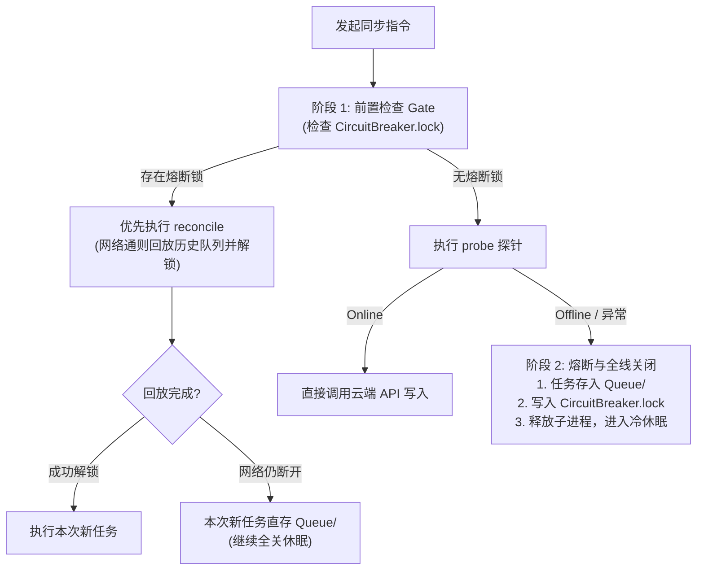

# Google Sync Guard (云同步卫士与熔断容灾网关)

Google Sync Guard 为 Antigravity 与 Google Workspace（Sheets, Docs, Drive, Calendar）之间提供**写前缓存（Write-Ahead Log）**、**异常熔断全关（Circuit Breaker & Clean Shutdown）**与**再次唤醒时自动回放（Reconciliation-on-Invocation）**的工业级闭环。

---

## 1. 核心运行原则 (Core Operational Rules)

当 Agent 向 Google 云端发起同步任务时，遵循三阶段生命周期：



---

## 2. 存储规范与目录定义 (Schema A)

所有数据完全内聚在 Agent 配置栈内，不污染工作区与外部磁盘：
* **根目录**：`C:\Users\hejia\.gemini\sync_buffer\`
* **待同步队列**：`C:\Users\hejia\.gemini\sync_buffer\Queue\`
  * `Sheets\`：表格增量行数据
  * `Docs\`：文档及 Markdown 草稿
  * `Drive\`：固件、BOM 表与附件实体
  * `Calendar\`：日程事件
* **已同步归档**：`C:\Users\hejia\.gemini\sync_buffer\Archived\`
* **运行日志**：`C:\Users\hejia\.gemini\sync_buffer\Logs\`
* **熔断锁标志**：`C:\Users\hejia\.gemini\sync_buffer\CircuitBreaker.lock`

---

## 3. CLI 命令快速参考

```bash
# 1. 综合状态检查 (查看熔断锁与待办队列)
python C:\Users\hejia\.gemini\config\skills\google-sync-guard\scripts\sync_guard_cli.py status

# 2. 探针测速 (耗时 ~200ms)
python C:\Users\hejia\.gemini\config\skills\google-sync-guard\scripts\sync_guard_cli.py probe

# 3. 措施落盘 (以 Sheets 为例存入 Queue/Sheets/)
python C:\Users\hejia\.gemini\config\skills\google-sync-guard\scripts\sync_guard_cli.py enqueue --service sheets --name "BOM_List" --data '{"part":"STM32F401","qty":5}' --note "样板采购"

# 4. 触发安全熔断并全线关闭
python C:\Users\hejia\.gemini\config\skills\google-sync-guard\scripts\sync_guard_cli.py trip --reason "Clash proxy disconnected"

# 5. 再次唤醒时：自动前置回放并解锁
python C:\Users\hejia\.gemini\config\skills\google-sync-guard\scripts\sync_guard_cli.py reconcile

# 6. 查看待办列表
python C:\Users\hejia\.gemini\config\skills\google-sync-guard\scripts\sync_guard_cli.py list
```
