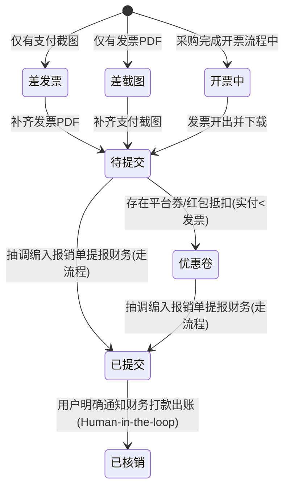

# 高校竞赛发票报销与合规审计专家 (Invoice & Reimbursement Master)

本技能用于高校大学生科技竞赛（如 RoboMaster、电子设计竞赛、智能车等）物料采购发票的智能识别归档、合规审计核验、差额对账、生命周期管理、目标金额凑单抽调与总账生成，严格对标高校财务处报销规范。

---

## 核心业务能力总览 (Three Core Pillars)

```
┌────────────────────────────────────────────────────────────────────────┐
│                        Invoice Audit Master                            │
├─────────────────────┬──────────────────────────┬───────────────────────┤
│   能力 1: 单据摄取   │    能力 2: 规范校验      │    能力 3: 目标凑单   │
│   智能归档与缺失标定 │    三要素与状态标定      │    专项包与双向防重   │
├─────────────────────┼──────────────────────────┼───────────────────────┤
│ • 自动识别品名与金额 │ • 抬头: 武汉轻工大学      │ • 目标预算动态逼近    │
│ • 队伍/人员缺失拦截  │ • 税号: 124200004416255673│ • 单张 <= 500元大额优先│
│ • 成组单据确认机制   │ • 单张面额 <= 500.00 元   │ • 专包 01-两位补零    │
│ • 缺失标记:          │ • 全生命周期状态机标定   │ • 源条目就地 _已提交 锁│
│   _差发票 / _差截图  │ • 操作后动态状态流转     │ • 11列 Excel 卡片合并 │
│ • 时间待标定动态流转 │ • 双月(~2个月)提醒标定   │ • 工作区自产生自清理  │
└─────────────────────┴──────────────────────────┴───────────────────────┘
```

---

## 1. 赛季层级、单据摄取与交互确认规约 (Capability 1: Hierarchy & Ingestion)

### 1.1 赛季、队伍与时间节点层级组织规约 (Season, Team & Milestone Hierarchy)
* **26赛季顶层分类（4 大业务单元）**：
  1. `主赛`
  2. `一队障碍`
  3. `一队任务`
  4. `二队任务`
* **三级提交归集硬性要求**：
  用户提交单据时，系统按 `赛季 -> 队伍 -> 人员` 建立目录。凡缺少“队伍”或“人员”信息的，Agent 必须立刻主动拦截提问确认，严禁擅自猜测或散落放置。
* **“时间待标定”动态过渡池与双月提醒机制**：
  1. **过渡目录命名**：各队伍下统一设立 `{队伍名}（时间待标定）`（例：`主赛（时间待标定）`、`一队障碍（时间待标定）`）；
  2. **新发票归集流向**：上一个时间节点（如 `2026.10.29`）之后产生的新发票，统一规整入对应队伍的 `{队伍名}（时间待标定）` 中；
  3. **动态阶段人员目录规范**：在时间节点未封闭前，人员文件夹保持纯名字（如 `何佳瑞`、`孙锦浩`），不带金额后缀；
  4. **双月（约 2 个月）巡检提醒**：系统在日常交互中观察距离上次标定时间戳；满 2 个月（如 2026.12.29 前后）主动提醒用户：“*当前时间节点已运行约 2 个月，请确认是否为【时间待标定】目录敲定正式时间节点？*”；
  5. **时间节点封闭与结算规约**：
     * **批次重命名**：由用户敲定日期后，批次目录更名为 25 赛季完整规范：`{队伍名}报销（YYYY.MM.DD）（支付{支付金额}_发票{发票金额}）`；
     * **人员目录追加金额**：系统批量核算各人员申报总额，自动为人员目录追加金额后缀：`{姓名}_{申报总额}`（例：`何佳瑞_1480.5`）；
     * **输出总账**：自动生成该批次标准 11 列 Excel 总账；
     * **循环新建过渡池**：封闭完成后，立刻在该队伍下新建下一个周期的空的 `{队伍名}（时间待标定）` 目录。

### 1.2 识别提取与物料文件夹命名
* **输入单据**：发票（PDF/电子发票图片）或购物凭证（淘宝、京东、立创、微信/支付宝扣款截图）。
* **自动提取要素**：采购品名、规格型号、实际支付金额、发票票面金额、开票人、商家名称。
* **常规标准命名格式**：`{序号}-{品名规格}_{金额}[_{状态标记}]`
  * **序号连接符**：必须使用短横线 `-`（严禁使用空格、下划线 `_` 或英文句点 `.`，例：`1-电机_100`）。
  * **品名与金额连接符**：必须使用单下划线 `_`（例：`螺丝_91.83`）。
  * **状态后缀**：单下划线连接 `_差发票`、`_差截图`、`_开票中`、`_优惠卷`、`_代付`、`_已提交`、`_已核销`、`_已报销`。

### 1.3 交互确认与路径提醒协议 (Proactive Clarification Protocols)
* **归属目录缺省提醒**：当用户提供发票或截图，但**未明确说明归属赛季、队伍或购买人**时，Agent **必须主动询问提醒**：
  > “*已识别到该物料（[品名]，金额 [xx] 元），请确认该条目应归档至哪个队伍及人员目录（例如：26赛季/主赛/何佳瑞）？*”
* **成组单据澄清确认**：当用户一次性提供多张发票或购物截图（一组一组提供），且**未明确说明分组归属或对应关系**时，Agent **严禁擅自猜测合并**，必须主动列出识别到的各组物料清单向用户发起确认：
  > “*识别到您提供的 [N] 组物料/单据如下：*  
  > *1. [品名A]（支付 [xx] 元，发票 [xx] 元）*  
  > *2. [品名B]（支付 [xx] 元，发票 [xx] 元）*  
  > *请确认是否按上述对应关系分别建立文件夹？*”

### 1.4 凭证缺失状态标定与多模态发票兼容（成对闭环）
物料建档要求发票凭证与支付截图凭证必须成对闭环：
* **多模态发票兼容原则（PDF 与发票图片双通道）**：
  * 发票凭证既包含 `.pdf` 电子发票，也完全兼容历史单据中以 `.jpg` / `.png` / `.jpeg` 保存的电子发票凭证；
  * **图像宽高比与 OCR 双重判别**：电子发票图片通常为横版（宽高比 $W/H \approx 1.2 \sim 1.7$）或长截屏，而手机支付截图通常为竖屏（$W/H \approx 0.4 \sim 0.6$）；
  * 当文件夹内包含多张图片但无 PDF 时，必须先识别是否包含发票图片，严禁直接误判为“差发票”。
* **只有截图，缺少发票**：文件夹命名必须追加 **`_差发票`**（例：`40-按键开关_2.5_差发票`）。
* **只有发票，缺少截图**：文件夹命名必须追加 **`_差截图`**（例：`12-转接线_45_差截图`）。
* **单据补齐后流转**：当补入缺失的发票或截图后，该目录自动消除 `_差发票`/`_差截图` 后缀，升级为正常待提交条目（如存在平台差额则转为 `_优惠卷`）。

### 1.5 缓存区 (TEMP) 与全域动态池常态化巡检规约 (Buffer Zone Inspection)
* **强制纳入全盘审计池**：在执行任何全盘发票查重、合规校验、总账复核或可用预算抽调时，系统必须强制将各赛季下的缓存区（如 `27赛季/TEMP`）纳入统一扫描范围，杜绝漏检漏查；
* **缓存区三分类管控机制**：
  1. **已闭环待建档**：发票与付款截图齐全，达到报销合规标准但尚未编入报销单，在下一次专项建档或批次封闭时优先吸收；
  2. **待补发票（差发票）**：仅有付款截图，统一强制追加 `_差发票` 后缀并导出待补清单，定向催促开具高校抬头发票；
  3. **跨库已迁移标记**：若缓存区物资已在正式库补齐发票并提报，源缓存区条目标记为 `_已迁移[队伍/主赛]正式库`，避免重复计算总额。

---

## 2. 发票合规硬核校验与全生命周期状态标定 (Capability 2: Compliance & Lifecycle)

### 2.1 高校财务合规三要素（硬核红线）
每次摄入发票或全盘审计时，强制执行三要素机器检验：
1. **发票抬头**：必须完全匹配 **`武汉轻工大学`**（严禁个人抬头、严禁拼音、严禁简称）。
2. **统一社会信用代码/税号**：必须完全匹配 **`124200004416255673`**。
3. **单张发票面额上限**：**单张发票价税合计不得超过 500.00 元**（$Amount \le 500.00$ 元）。
   * 若采购单项总价超过 500 元，必须在开票时联系商家分拆开具为多张单张 $\le 500.00$ 元的子发票。
   * 单张发票票面金额 $> 500.00$ 元的，审计工具将作为高风险异常拦截并报告，避免财务退单。

### 2.2 全生命周期状态状态机 (Lifecycle State Machine)



* **状态机自动推进封顶红线（已提交封顶）**：
  - 自动凑单、生成专项报销包与源目录加锁操作的**状态机最高边界严格止步于 `_已提交`**；
  - **严禁系统擅自判定或自动升级为 `_已核销` / `_已报销`**；
  - 即使报销包创建已久或历史归档，只要未经用户明确告知，所有账目在看板与目录中必须如实保持“已提交待核销（走流程中）”；
* **核销终态人工触发机制 (Human-in-the-loop Write-off Protocol)**：
  - 报销包的本质是“走流程”，实际审核打款受高校财务处排期影响；
  - 仅当用户明确发出指令（例：“xx报销包已经核销了”、“财务已经打款到账”、“Batch 1 已报销”）时，系统方可将对应报销包及源目录从 `_已提交` 批量升级为 `_已核销` / `_已报销`。

### 2.3 状态标签定义与使用场景
| 状态标记 | 触发场景与业务含义 | 目录命名示例 |
| :--- | :--- | :--- |
| **`_差发票`** | 仅有付款截图，尚未取得有效发票 | `40-按键开关_2.5_差发票` |
| **`_差截图`** | 仅有发票 PDF，缺少支付/扣款记录凭证 | `12-转接线_45_差截图` |
| **`_开票中`** | 商家已受理开票或批量开票未取（如立创批量订单） | `2-网线_25.68_开票中` |
| **`_优惠卷`** | 存在平台红包/店铺满减，实付金额 $<$ 发票金额 | `23-摆动气缸_77.6_优惠卷` |
| **`_代付`** | 订单由团队其他成员代付结算 | `2-IM6014电机_980_代付` |
| **`_已提交`** | 已抽调编入特定报销包并递交财务，源目录锁死防重 | `1-灵足电机RS02_665.1_已提交` |
| **`_已核销` / `_已报销`** | 财务审核通过并完成打款/冲账，该发票完全出库 | `5-航模电机_710_已报销` |
| **`(已核查)`** | 整批或全赛季历史总账核对无误（用于批次主目录） | `二队报销(2026.8.17)...(已核查)` |

---

## 3. 目标金额动态凑单抽调与跨库双向防重 (Capability 3: Budget-Targeted Extraction)

当用户给出目标申报额度（如“凑一个将近 2 万元的报销单”、“大概 1.5 万元左右”）时，执行标准化抽调流程：

### 3.1 预算候选池筛选与“大额优先”策略
1. **可用池过滤**：从可用物料池中筛选，自动剔除带 `_已提交`、`_已核销`、`_已报销`、`_差发票`、`_差截图`、`_开票中` 的未就绪条目；
2. **硬性面额过滤**：强制剔除单张发票 $> 500.00$ 元的未拆票条目；
3. **大额优先原则 (Large-Amount Priority)**：
   * 优先提取单项采购总额较大、发票张数相对紧凑的合规拆票物料（如 4403.7元、1796.4元、1437元、1226元等）；
   * 减少零碎小额发票条目，降低财务审核与单据整理的碎片化成本；
   * 通过动态规划/贪心算法逼近目标金额，向用户呈报拟选清单与张数，获得确认后实施。

### 3.2 专项报销包规范与双向防重锁定
1. **建立专项报销包根目录（顶层归集规约）**：
   * **放置路径（强制顶层存放）**：专项报销包**必须直接建立在生活与财务域的 `比赛发票/` 顶级目录下**（例：`比赛发票/两万报销单_已提交_10.30`、`比赛发票/一万报销单_已提交_11.03`），与各赛季源库存目录（`25赛季/`、`26赛季/`）物理并列并彻底解耦；**严禁**将抽调生成的专项报销包嵌套存入子赛季目录内部，避免污染历史赛季源库存树或导致跨库查重重复扫描。
   * **命名格式**：`{报销主题/包名称}_{状态}[_{MM.DD}]`（例：`两万报销单_已提交_10.30`、`一万报销单_已提交_11.03`）。
2. **源库存条目强制实时同步加锁（标记 `_已提交`，只准复制不准剪切）**：
   * **每次操作实时重命名准则（Real-Time In-Place Marking）**：凡是被选入、抽调或打包进任意报销单的源物料文件夹，**系统在生成报销包或确认提报的同一流水线操作中，必须立刻、无缝回写原赛季源目录，就地重命名追加 `_已提交` 状态标记**（若已包含 `_已提交` 或 `_已报销` 则跳过）；
   * **严禁遗漏源目录标记**：绝对禁止仅将文件复制入报销包而保持源目录不改名，杜绝在文件管理器翻看源目录时产生“未收录/漏报”的视觉误解与审计歧义；
   * **只准复制文件至专项报销包，严禁直接剪切移走**，保持历史赛季批次完整性与全赛季对账可追溯性。
3. **专包内物料两位补零排序**：
   * 复制至专包后，文件夹序号采用两位补零前导规范：`01-`、`02-`...`29-`...`46-`；
   * 专包内部物料无需再加 `_已提交` 后缀（由专包根目录统一表示）。
4. **生成标准 11 列 Excel 总账**：
   * 文件名规范：`{报销单名称}总账（发票{总金额}元）.xlsx`；
   * 发票号码强制写入文本格式 `@`，杜绝科学计数法；
   * 多发票条目执行左侧字段跨行卡片式合并（Merge Cells）；
   * 末尾配置标准 `=SUM()` 公式合计行。
5. **报销包“走流程”属性与核销终态解耦规约 (Reimbursement Workflow & Write-off Decoupling)**：
   * **业务本质**：抽调物料并总出报销包（打包、打表、编号）的本质是“准备纸质单据推进财务申报审核流程”，绝对不代表资金已经打款核销出账；
   * **源目录锁死为 `_已提交` 封顶**：源物料目录一律标记 `_已提交` 锁，既防止后续被重复提取，又明确体现其处于申报审核中；
   * **严禁越权定态**：无论用户何时询问源目录状态或执行全盘资产巡检，系统严禁将走流程中的单据擅自判定为“已结清”或“已核销”，杜绝财务账目虚增或过早销账；
   * **人工指令唯一触发**：只有在用户明确告知“某批次已核销/已打款”时，系统方可将对应报销包及源目录升级为 `_已核销` / `_已报销`。

### 3.3 专项报销包双文件夹标准架构 (Dual-Folder Separation Protocol)
报销单根目录下统一收拢并解耦为两个核心顶级子文件夹：
```
{报销单名称}/
├── 📁 打印资料/                                       # 打印递交与纸质单据专用区
│   ├── 📁 发票汇总/                                   # 集中存放全部按总账顺序严格编号的纯净发票文件
│   └── 📄 {报销单名称}总账（发票{金额}元）.xlsx         # 标准 11 列报销 Excel 总账
└── 📁 物料材料明细/                                   # 全量原始凭证与支付留痕归档区
    ├── 📁 01-{物料名}_{金额}/                         # 保留该物料的原始发票与全部支付截图
    └── ...
```
* **打印资料 (Print Zone)**：面向财务处打印递交。用户或打印店可进入 `发票汇总/` 一键批量打印全量发票，出纸顺序与 Excel 总账行序 100% 对齐；
* **物料材料明细 (Audit Zone)**：面向后续财务抽查与电子留痕。各采购物料的淘宝/京东/微信支付截图、商家订单凭证与发票原件在此完好封存。

### 3.4 发票原件保真与严禁光栅化渲染红线 (Anti-Rasterization & Digital Integrity Rule)
* **严禁光栅化渲染 (Strictly No Rasterization)**：
  * **硬性红线**：严禁调用任何图像渲染管线（如 `fitz.get_pixmap()`、`pdf2image` 等）将电子发票 PDF 强制栅格化（转为 PNG/JPG 位图）；
  * **业务机理**：数电发票与全电发票内含全国统一税务数字签名、防伪时间戳证书与矢量印章流。转为位图后将彻底丢失结构化元数据与数字验真能力，放大易产生锯齿失真，存在被财务查验系统判定为“二次合成假票/伪造凭证”的严重退单风险；
  * **纯净文件操作原则**：对发票文件的提取、归档与序号整理，**必须执行原生二进制文件复制（Binary File Copy）**，仅通过前置规范序号前缀（如 `01_`、`01-01_`）实现排序，严禁篡改发票内部数据流或拼图重制。

---

## 4. 优惠券与红包差额记账规约 (Coupons & Discounts Protocol)

当实际支付金额因平台红包、店铺满减导致实付金额小于发票金额时：

1. **文件夹标记**：
   * 文件夹名称中的金额**必须标注发票票面金额**（而非支付金额），并在末尾追加 `_优惠卷` 标签；
   * 例：实付 378.00 元，发票票面金额 390.80 元 $\rightarrow$ 目录命名为 `32-canfd分析仪+达妙开发板+IMU_390.8_优惠卷`。
2. **Excel 总账留痕**：
   * `支付记录金额`：如实填写实付金额。
   * `发票金额`：填写发票票面合计金额。
   * `发票总金额对不上支付记录金额请说明理由` 列：显式注明差额原因（例：`淘宝平台优惠12.8元`、`店铺红包减免5元`）。

---

## 5. 实物平替与商家类目差异规约 (Substitutions & Category Discrepancies)

1. **实物平替发票 (替票/价格平替)**：
   * 当实际采购物料无法开具高校抬头发票，使用等额的其他正规发票平替时：
     * **目录命名**：保留竞赛实际使用的物料品名与申报金额（例：`19-小米机器狗足端_154`）。
     * **Excel 购买用途列**：必须显式声明平替关系，格式统一为：
       > `[真实物料用途]（[发票开具物料]价格平替）`  
       > 例：`焊枪（小米机器狗足端价格平替）`
2. **商家自动类目编码差异**：
   * 某些商家因开票税目预设（如螺丝刀开为零件盒、热熔胶开为套装工具、顺丰补邮开为工业摄像头）：
     * 保持实际购买物料的文件夹命名；
     * 在 Excel 总账备注或用途列说明实际用途（例：`顺丰补邮`、`45合1螺丝刀套装`）。

---

## 6. 标准 11 列报销 Excel 生成标准 (Standard Ledger Specification)

报销汇总 Excel 必须严格采用以下标准 11 列字段头与排版参数：

| 列号 | 字段名称 | 对齐方式 | 数据格式 | 填写规范与约束 |
| :---: | :--- | :---: | :---: | :--- |
| **A** | 购买人 | 居中 | 文本 | 申报人姓名（多发票条目跨行合并） |
| **B** | 位置编号 | 居中 | 整数 | 序号（从 1 递增，对应文件夹序号，多发票跨行合并） |
| **C** | 购买物件名称 | 靠左 | 文本 | 采购物料具体品名与规格（多发票跨行合并） |
| **D** | 数量 | 居中 | 整数/数值 | 采购物料数量（多发票跨行合并） |
| **E** | 单价 | 靠右 | `#,##0.00` | 单价（保留 2 位小数，多发票跨行合并） |
| **F** | 总价 | 靠右 | `#,##0.00` | 数量 $\times$ 单价（多发票跨行合并） |
| **G** | 支付记录金额 | 靠右 | `#,##0.00` | 截图显示的实际扣款金额（多发票跨行合并） |
| **H** | 发票编号 | 居中 | `@` (文本) | **20位/8位纯数字发票号（文本格式，严禁科学计数法）** |
| **I** | 发票金额 | 靠右 | `#,##0.00` | 发票右下角价税合计（小写金额，逐行独立列出） |
| **J** | 购买用途 | 靠左 | 文本 | 研发具体用途（平替时按规约显式注明，多发票跨行合并） |
| **K** | 理由说明 | 靠左 | 文本 | 发票总额与支付金额有差额时的理由（多发票跨行合并） |

* **排版样式**：表头高度 28 pt，淡蓝灰填充 `#D9E1F2`，加粗居中；数据行高度 20 pt，细灰边框 `#B0B0B0`；末行 A~F 列合并居中显示“合计”（淡黄底色 `#FFF2CC`），G 列与 I 列配置 `=SUM()` 动态公式。

---

## 7. 自动化审计与总账工具 (CLI Tool)

```bash
# 1. 穿透式全合规审计与状态资产核算 (查重、税号、抬头、跳号、差额、差发票/差截图/已提交状态统计)
uv run --python 3.12 --with pypdf,openpyxl python "C:\Users\hejia\.gemini\config\skills\invoice-audit-master\scripts\invoice_auditor.py" --audit "<目标目录>"

# 2. 从已整理的物料目录自动生成标准 11 列 Excel 总账 (支持多发票跨行卡片合并)
uv run --python 3.12 --with pypdf,openpyxl python "C:\Users\hejia\.gemini\config\skills\invoice-audit-master\scripts\invoice_auditor.py" --generate-excel "<批次目录>" -o "<输出Excel路径>"
```

---

## 8. 工作区零污染与自动即时清理规约 (Zero-Pollution & Self-Cleanup Protocol)

在任何建档、凑单抽调、格式转换或对账操作中，必须严格恪守“自产生、自清理、零残留”准则：
1. **工作区目录纯净性**：
   * 严禁在用户工作区根目录（如 `比赛发票/`）残留任何测试目录、暂存目录（如 `scratch/`、`temp_*`）或非业务中间产物；
2. **中间暂存自动即时销毁**：
   * 凡因运算、图片转换、临时抽取建立的暂存文件夹，在核心任务完成并验证目标文件落盘后，**必须在同一操作流中自动执行清理与删除**；
3. **交付即定稿**：
   * 交付用户查验的工作区仅保留标准命名的赛季目录、专项报销包与唯一官方定稿 Excel，杜绝任何中间过渡痕迹。

---

## 9. 操作即落盘：看板 Markdown 与实时流水强制同步规约 (Real-Time Documentation Protocol)

每次针对单据归档、状态加锁（如追加 `_已提交`、`_差发票`）、凑单打包、总账生成或目录治理操作执行完毕后，**必须在同一流水线中无缝完成对应 Markdown 看板（如 `TASK.md`）的实时更新**：

1. **快照数据实时刷新**：
   * 同步更新已报销、已提交待核销、缓存区待补票等核心资产的项数与精确金额，确保看板数据与物理磁盘 100% 绝对一致。
2. **变更流水强制追加 (Operation Audit Log)**：
   * 看板中必须维护结构化操作流水表，每次操作必须记录：
     - `时间戳`（精确到分钟）；
     - `操作类型`（如全库审计、专包生成、源目录加锁、缓存区治理、异常修复等）；
     - `影响范围与变动详情`（变动前 $\rightarrow$ 变动后状态）；
     - `关联文件与落地资产链接`（使用可点击路径）；
     - `经办人/Agent`。
3. **杜绝“口头承诺未落盘”**：
   * 严禁仅在对话中回复完成情况而在工作区留下未经更新的陈旧 `.md` 文档；
   * 对话汇报前必须确认相关 `.md` 文件已完成写入并保存。

