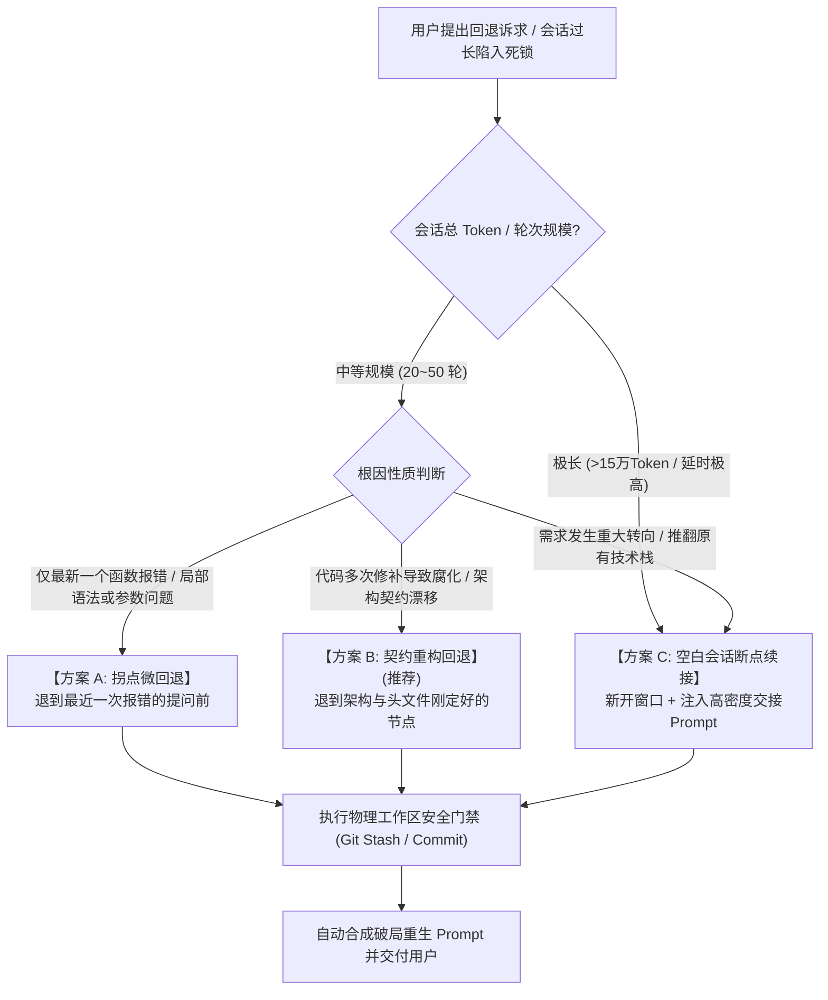

# 会话回退决策树与场景位点速查 (Session Checkpoint Decision Tree)

> **版本**：v1.0.0 | **所属技能**：`session-checkpoint-advisor`  
> **适用场景**：复杂代码开发、嵌入式软硬件联调、系统自动化运维中，当会话过长、上下文被污染或陷入重试死锁时，精准定位最佳回退节点。

---

## 1. 核心回退决策树 (Rewind Decision Tree)



---

## 2. 典型实战场景与最佳回退位点对照表 (Scenario Matrix)

| 场景代码 | 典型死锁/失调症状 | 错误回退方式 (反模式) | 最佳回退位点与操作 | 关键挽回价值 |
| :---: | :--- | :--- | :--- | :--- |
| **SC-01** | **嵌入式 DMA 接收死锁**<br>连续 8 轮修改中断回调与缓冲区，越改越复杂，引发 HardFault | 直接退到立项第一句（丢失引脚与时钟配置） | **退到【头文件与数据结构定义完成】轮次**：<br>保持外设引脚与帧头契约，仅重写驱动实现函数。 | 保留已对齐的硬件寄存器/时钟初始化，洗掉混乱的中断回调打补丁代码。 |
| **SC-02** | **全栈上下位机协议漂移**<br>上位机新增了字段但下位机没加，随后出现两端互相容错的魔数 | 在当前会话继续让 AI “兼容两个版本” | **退到【协议枚举 `UiMode_t` / 数据帧格式刚制定】轮次**：<br>双端同时重新对齐单一真实源 (SSOT)。 | 彻底斩断“历史兼容包袱”，避免代码变成千层饼。 |
| **SC-03** | **Linux / Windows 跨平台路径报错**<br>脚本在 Windows 跑通后移植 Linux，由于斜杠/换行符/权限反复报错 | 逐行给每个报错写 try-except | **退到【设计跨平台工具入口】轮次**：<br>要求统一使用 `pathlib.Path` 与规范 OS 分支。 | 架构级规避硬编码路径，从源头根除跨端问题。 |
| **SC-04** | **长会话注意力衰减 (模型遗忘规范)**<br>第 35 轮对话时，模型突然生成了全局硬编码路径或违背了零桌面入侵 | 严厉斥责模型并要求它“看上面的规则” | **直接采用【方案 C: 空白会话续接】**：<br>开启全新窗口，把当前磁盘实际代码和强约束注入新会话。 | 彻底摆脱注意力稀释，新会话 100% 严格执行前置规则。 |

---

## 3. 回退前“物理资产保全”三重门禁 (Triple Safety Gate)

1. **门禁一：未提交代码强制暂存 (Git Guard)**
   * 在执行会话回退或开启新会话前，必须确保物理磁盘改动不被遗失：
     ```bash
     # Linux / Windows 统一推荐
     git stash save "checkpoint-before-rewind"
     # 或打一个临时探索分支
     git checkout -b wip/checkpoint-backup
     ```
2. **门禁二：硬件与独占资源释放 (Resource Release)**
   * 若涉及单片机调试，确保已断开 pyOCD / OpenOCD 会话；
   * 若使用串口监控（如 VOFA+、PuTTY、Python serial），关闭串口占用，避免新会话中由于 `PermissionError: Access Denied` 导致误判。
3. **门禁三：磁盘代码与会话记忆显式对齐 (State Grounding)**
   * 必须在回退后的提示词中，显式声明“磁盘当前存在的有效改动文件”，防止 AI 假设磁盘代码已自动还原而执行破坏性重写。
